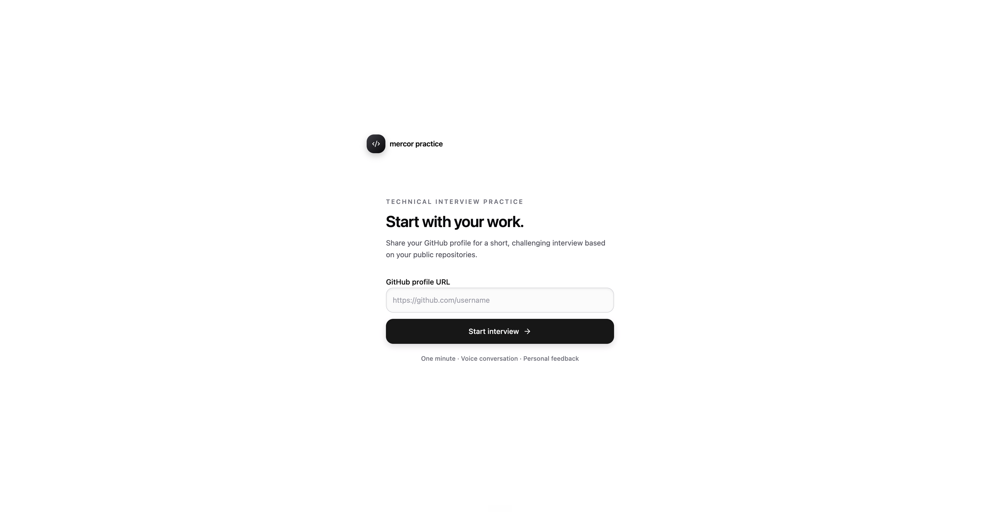

# GitHub Interview Practice

A voice-based technical interview practice app that uses a candidate’s public GitHub repositories to guide a short interview. After the conversation, it provides a score and feedback based on the candidate’s responses.

## Screenshots




## Features

- Collects a GitHub profile URL and reads public repository metadata.
- Runs a one-minute, two-way technical interview over browser audio.
- Asks questions grounded in the candidate’s repositories.
- Saves the interview transcript and scores the candidate’s answers.
- Shows the transcript, score, and feedback on the results page.
- Uses animated speaking indicators on the interview screen.

## Stack

- **Workspace:** Bun and Turborepo
- **Frontend:** React, TypeScript, React Router, Tailwind CSS
- **Backend:** Express, TypeScript, Zod
- **Database:** PostgreSQL with Prisma ORM
- **Voice interview:** OpenAI Realtime API over WebRTC
- **Interview scoring:** OpenAI Responses API

## Requirements

- Bun 1.3.13 or newer
- Node.js 24 or newer
- PostgreSQL 15 or newer
- An OpenAI API key with access to the configured Realtime and scoring models

The browser needs microphone permission. Use `localhost` during development or serve the app over HTTPS.

## Local setup

1. Install dependencies from the repository root:

   ```sh
   bun install
   ```

2. Create the backend environment file:

   ```sh
   cp apps/backend/.env.example apps/backend/.env
   ```

3. Edit `apps/backend/.env` and set `DATABASE_URL` to a PostgreSQL database and `OPENAI_API_KEY` to your server-side API key. The example also sets the local frontend origin, Realtime model, and scoring model.

   Keep the API key in the backend environment. It is used by the server to create short-lived Realtime credentials and score completed interviews.

4. Apply the database migrations:

   ```sh
   cd apps/backend
   bun run migration:apply
   cd ../..
   ```

5. Start the frontend and backend from the repository root:

   ```sh
   bun run dev
   ```

   Open [http://localhost:3000](http://localhost:3000). The backend listens on port `3001` by default.

The frontend uses `http://localhost:3001` as its default backend URL. To change it, create `apps/frontend/.env` and set `BUN_PUBLIC_BACKEND_URL` to your backend origin.

## Interview flow

1. Enter a GitHub profile URL on the landing page.
2. The backend collects public repository names, descriptions, and star counts.
3. Start the voice interview and answer questions about the listed projects.
4. End the interview or let the one-minute timer expire.
5. Review the transcript, score, and feedback on the results page.

## Useful commands

Run these from the repository root unless a directory is shown.

| Command | Description |
| --- | --- |
| `bun run dev` | Start the frontend and backend in development mode |
| `bun run check-types` | Type-check the workspace |
| `bun run build` | Build workspace packages |
| `bun run lint` | Run workspace lint tasks |
| `cd apps/backend && bun run migration:status` | Check database migration status |
| `cd apps/backend && bun run migration:apply` | Apply pending database migrations |

## Project layout

```text
apps/
  backend/   Express API, GitHub repository collection, interview sessions, scoring, Prisma schema
  frontend/  React app, interview UI, WebRTC audio connection, results UI
packages/
  ...        Shared workspace configuration and packages
```

## Configuration

Backend settings are documented in `apps/backend/.env.example`:

| Variable | Purpose |
| --- | --- |
| `DATABASE_URL` | PostgreSQL connection string |
| `OPENAI_API_KEY` | Server-side OpenAI API key |
| `FRONTEND_ORIGIN` | Frontend origin allowed by the backend CORS policy |
| `REALTIME_MODEL` | Realtime voice interview model |
| `SCORING_MODEL` | Model used to score interview answers |
| `PORT` | Backend port; defaults to `3001` |

The interview uses a temporary access token stored in the browser’s `sessionStorage`. The standard OpenAI API key stays on the backend.
